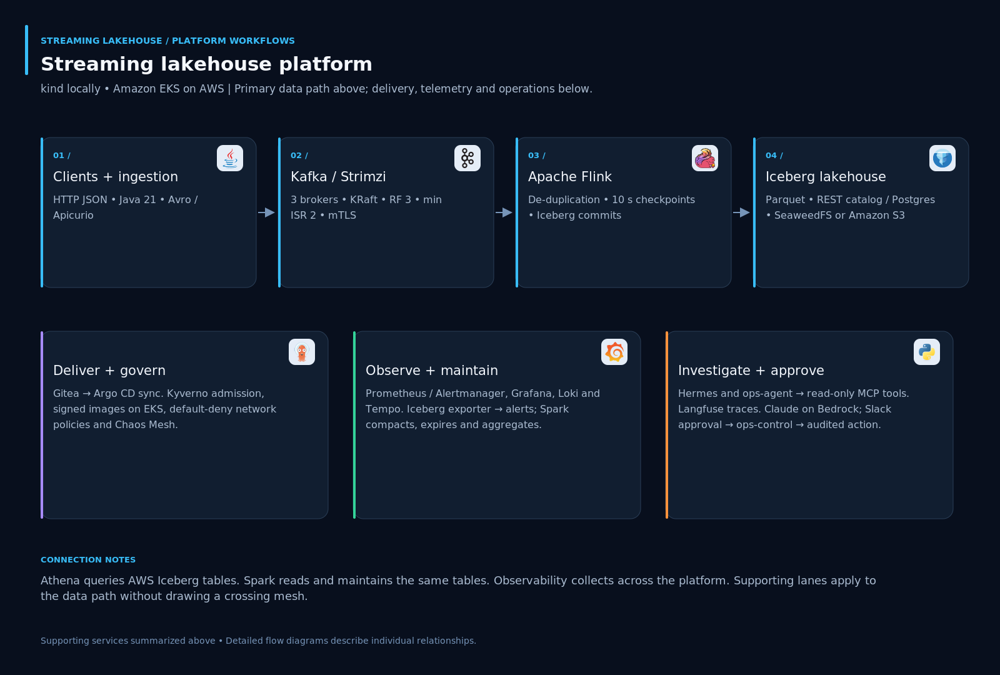
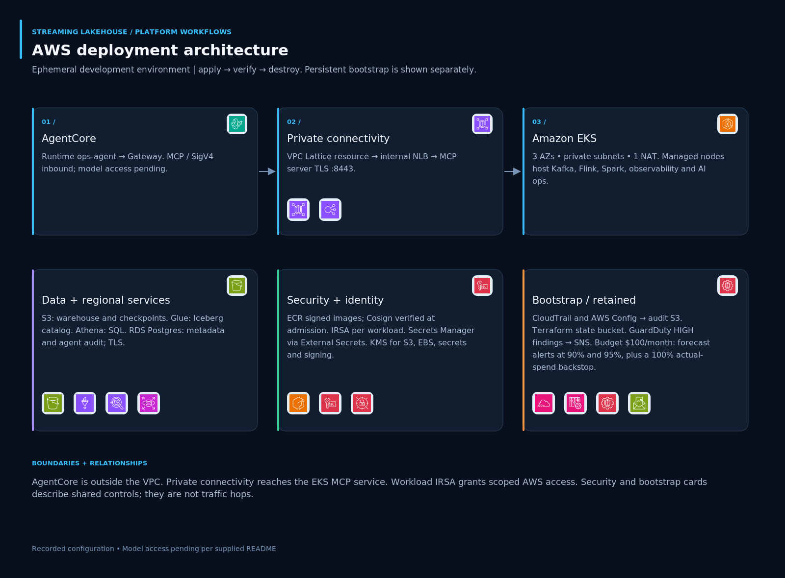
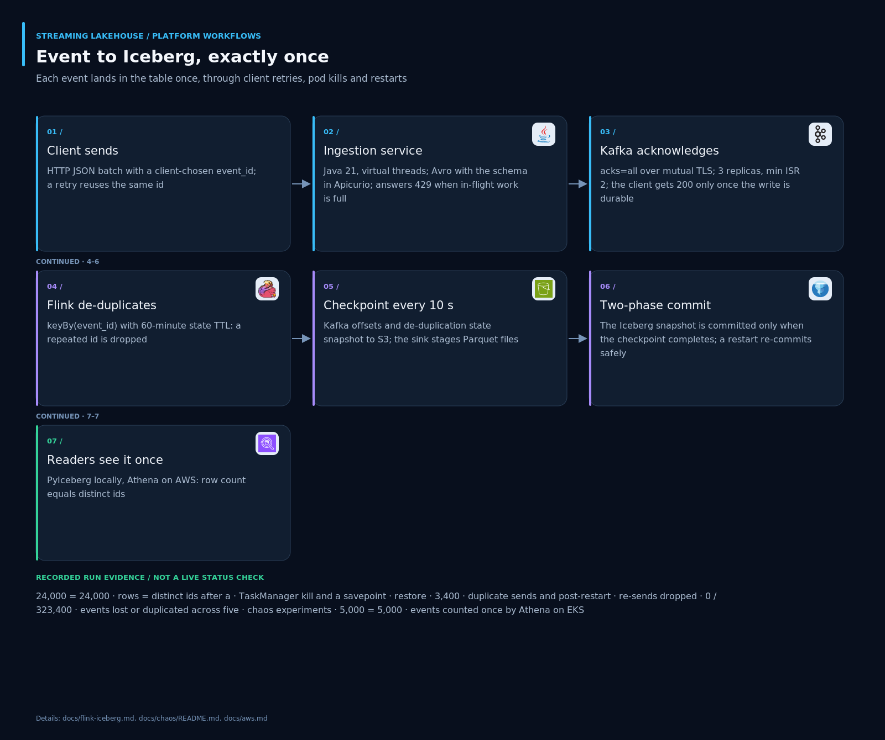
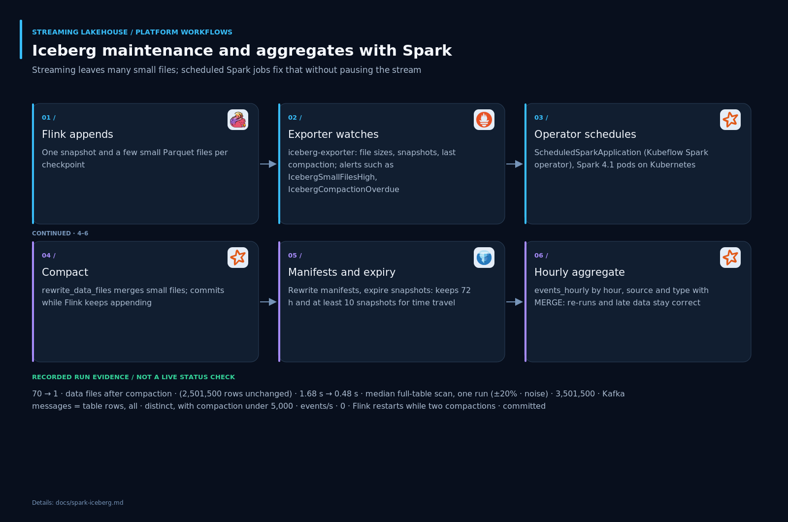
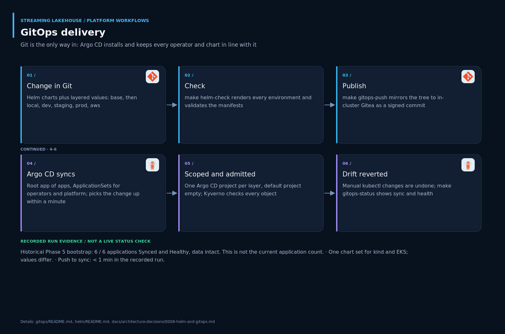
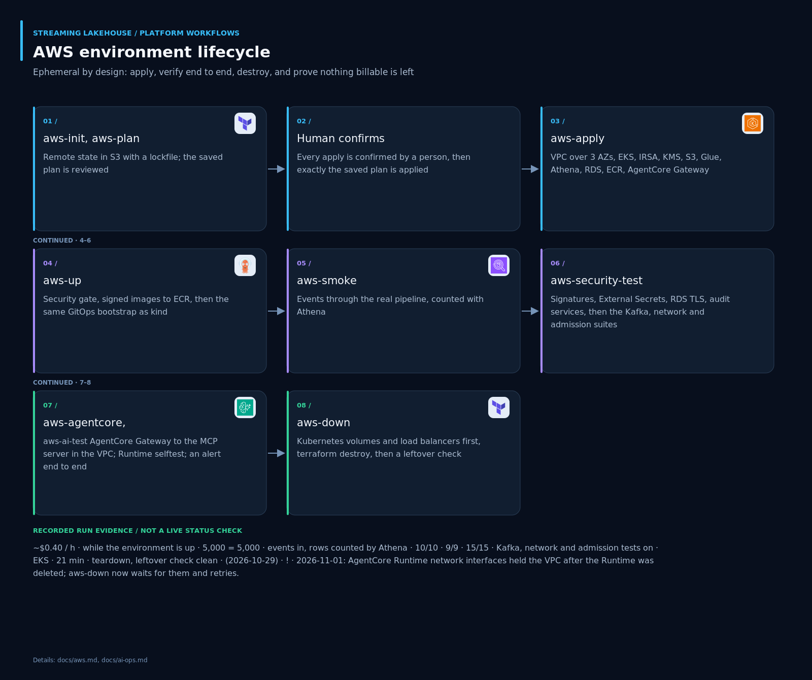
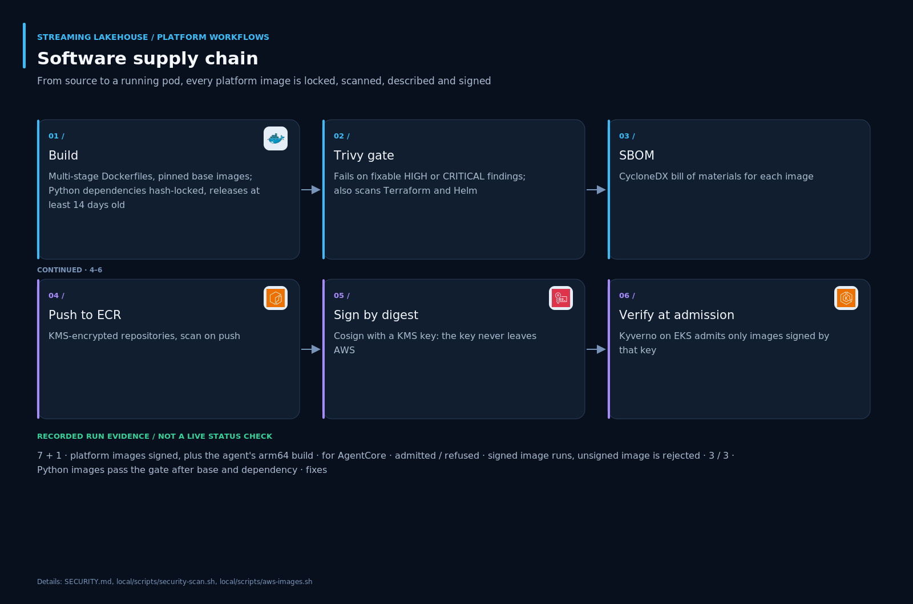
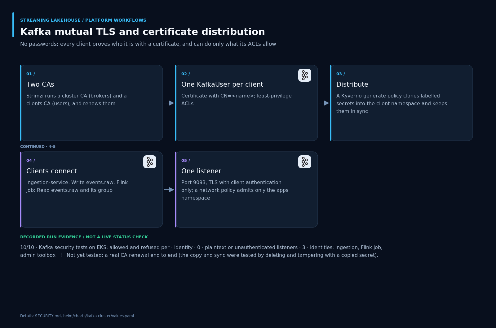
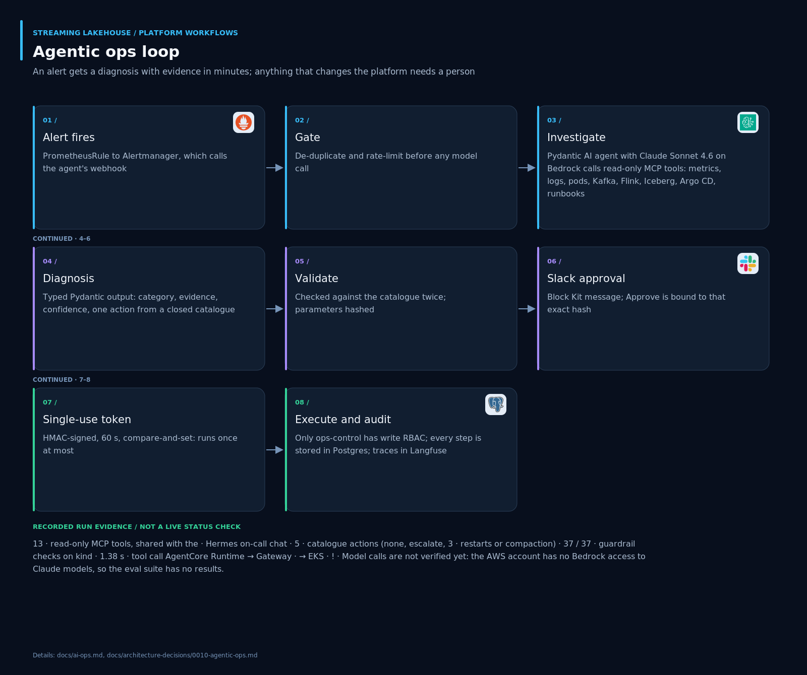

# **Diagrams**

Every diagram in the project is in this folder, in one dark style, each as SVG and PNG with the same name. The README, the docs and the portfolio page all link here.

| **Diagram**                                                                                                                  | **Shows**                                                                                          |
| ---------------------------------------------------------------------------------------------------------------------------- | -------------------------------------------------------------------------------------------------- |
| **architecture** ([SVG](architecture.svg), [PNG](architecture.png))                                                          | The platform on Kubernetes (kind locally, EKS on AWS): data path and supporting lanes              |
| **aws-deployment** ([SVG](aws-deployment.svg), [PNG](aws-deployment.png))                                                    | The AWS dev environment and the bootstrap stack                                                    |
| **workflow-ingestion-exactly-once** ([SVG](workflow-ingestion-exactly-once.svg), [PNG](workflow-ingestion-exactly-once.png)) | Client to Iceberg exactly once: idempotent ids, `acks=all`, Flink de-duplication, two-phase commit |
| **workflow-spark-maintenance** ([SVG](workflow-spark-maintenance.svg), [PNG](workflow-spark-maintenance.png))                | Compaction, manifest rewrite, snapshot expiry and the hourly aggregate while Flink keeps writing   |
| **workflow-gitops-delivery** ([SVG](workflow-gitops-delivery.svg), [PNG](workflow-gitops-delivery.png))                      | Git, Gitea, Argo CD, admission, drift correction                                                   |
| **workflow-aws-lifecycle** ([SVG](workflow-aws-lifecycle.svg), [PNG](workflow-aws-lifecycle.png))                            | Plan, apply, up, smoke, security test, AgentCore, down                                             |
| **workflow-supply-chain** ([SVG](workflow-supply-chain.svg), [PNG](workflow-supply-chain.png))                               | Build, Trivy gate, SBOM, ECR, Cosign signature, verification at admission                          |
| **workflow-kafka-mtls** ([SVG](workflow-kafka-mtls.svg), [PNG](workflow-kafka-mtls.png))                                     | Strimzi CAs, one KafkaUser per client, certificate distribution by Kyverno, the mTLS listener      |
| **workflow-agentic-ops** ([SVG](workflow-agentic-ops.svg), [PNG](workflow-agentic-ops.png))                                  | Alert, agent investigation through MCP tools, Slack approval, single-use token, audited execution  |

[**`banner.jpg`**](banner.jpg) (1600 × 533) is the README banner: an AI-generated scene of the Singapore waterfront, a decorative composite, with the technology logos laid over it.

## **Architecture**





## **Workflows**

One infographic per major flow: numbered steps and the measured numbers from recorded runs. The footer of each names the document with the details.















## **Changing a diagram**

The dark diagrams were made with a separate generator that is not in this repository, so nothing here rebuilds them. To change one, edit its SVG and export a PNG at the same size with CairoSVG 2.8.2 and the DejaVu fonts. That pipeline reproduced the existing `workflow-ingestion-exactly-once.png` pixel for pixel (checked 2026-11-18; rsvg-convert spaces the text slightly wider). From the repository root in Git Bash, with `<name>` replaced:

```bash
MSYS_NO_PATHCONV=1 docker run --rm -v "$(cygpath -w "$PWD/docs/diagrams"):/w" -w /w python:3.14.7-slim-trixie sh -c 'apt-get update -qq && apt-get install -y -qq --no-install-recommends libcairo2 fonts-dejavu-core && pip install -q cairosvg==2.8.2 && python -c "import cairosvg; cairosvg.svg2png(url=\"<name>.svg\", write_to=\"<name>.png\")"'
```

`make diagrams` draws light reference versions from code in [**`local/tools/diagrams/`**](../../local/tools/diagrams/) into `build/diagrams/` (git-ignored) and never writes to this folder. The numbers in the workflow infographics live in the `WORKFLOWS` list of `workflows.py`, taken from the results docs: when a result changes, update that list and the dark SVG. It needs `uv` and Graphviz (`dot`) on the PATH, and installs the hash-locked [**`requirements.txt`**](../../local/tools/diagrams/requirements.txt) (the Python [**`diagrams`**](https://diagrams.mingrammer.com/) library 0.25.1) into `build/diagrams-venv`.

## **Logos and trademarks**

The diagrams use the official [**AWS Architecture Icons**](https://aws.amazon.com/architecture/icons/), the Apache Flink and Apache Iceberg logos from the projects' websites, and other technology logos from [**Devicon**](https://devicon.dev/).

- The logos are used only to identify the technology each box stands for. They do not imply endorsement by, or affiliation with, any of these projects or companies.
- All names and logos are trademarks of their respective owners. Apache Kafka, Apache Flink, Apache Spark and Apache Iceberg are trademarks of the Apache Software Foundation. AWS and the AWS service names are trademarks of Amazon.com, Inc. or its affiliates. Kubernetes is a trademark of the Linux Foundation.
