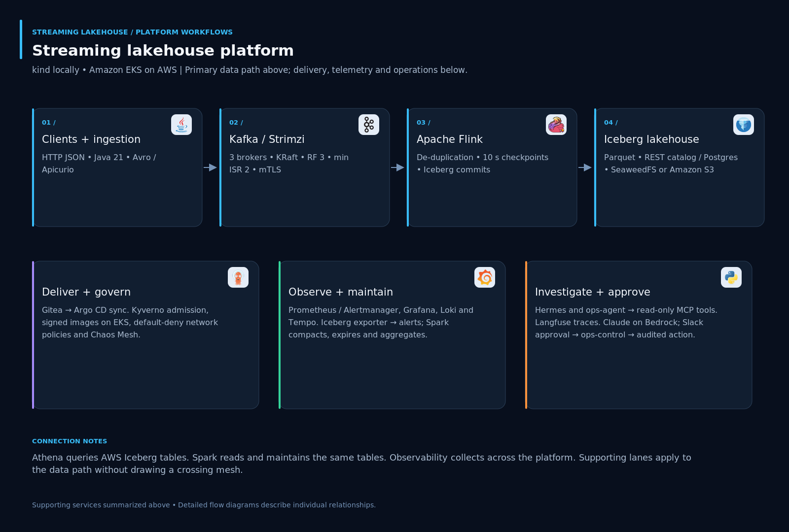

## **Streaming Data Lakehouse Platform**

Documentation for a Kubernetes-native streaming lakehouse: Kafka (Strimzi), Flink exactly once into Apache Iceberg, Spark maintenance, Helm and Argo CD, an ephemeral Amazon EKS environment built with Terraform, and an agentic ops assistant with human-approved actions. The project overview and measured results are in the [**README**](../README.md).

| **Section**       | **Pages**                                                                                                                                        |
| ----------------- | ------------------------------------------------------------------------------------------------------------------------------------------------ |
| **Start here**    | [**Lab runbook**](lab/RUNBOOK.md), [**diagrams and workflows**](diagrams/README.md)                                                              |
| **Decisions**     | [**ADR 0001**](architecture-decisions/0001-local-first-kind-with-ephemeral-eks.md) to [**ADR 0010**](architecture-decisions/0010-agentic-ops.md) |
| **Data pipeline** | [**Flink to Iceberg results**](flink-iceberg.md), [**Spark results**](spark-iceberg.md), [**JVM performance**](performance/README.md)            |
| **Operations**    | [**Observability**](observability.md), [**runbooks**](runbooks/), [**chaos experiments**](chaos/README.md), [**ops agent**](ai-ops.md)           |
| **AWS**           | [**Running the AWS environment**](aws.md)                                                                                                        |
| **Security**      | [**Controls, tests and reporting**](../SECURITY.md), [**NIST SP 800-53 mapping**](security/control-mapping.md)                                   |
| **Project**       | [**Contributing**](../CONTRIBUTING.md), [**code of conduct**](../CODE_OF_CONDUCT.md)                                                             |
