# **Lab Runbook: Streaming Lakehouse Platform**

Step by step, from an empty machine to a running platform: the local kind cluster first (Parts 1 to 8), then the optional AWS environment (Part 9), then shutdown (Part 10). Each part says what to run, what you should see, and which screenshot to take.

| **Part**                                      | **Time**                    | **Cost**                              |
| --------------------------------------------- | --------------------------- | ------------------------------------- |
| **0. Prerequisites**                          | 30-60 min (first time only) | free                                  |
| **1. Local platform up**                      | 20-40 min (first run)       | free                                  |
| **2. Tour of the UIs**                        | 15 min                      | free                                  |
| **3. Events, exactly once, schema evolution** | 20 min                      | free                                  |
| **4. Spark maintenance and aggregates**       | 15 min                      | free                                  |
| **5. GitOps change and drift**                | 10 min                      | free                                  |
| **6. Security checks**                        | 15 min                      | free                                  |
| **7. Alerts and a chaos experiment**          | 20 min                      | free                                  |
| **8. The ops agent**                          | 20 min                      | free (model runs need Bedrock access) |
| **9. AWS environment (optional)**             | 1.5-2 h                     | about $0.40 per hour while up         |
| **10. Shutdown**                              | 5-25 min                    | free                                  |

The alert runbooks in [**docs/runbooks/**](../runbooks/) (ingestion, Kafka, pipeline, lakehouse, platform, ops agent) are for operating the platform once it runs; this file is the lab itself.

## **Sign-in reference**

All local credentials are throwaway values for the kind cluster; they exist only on your machine. Start the port-forwards first with `make local-ports` (leave it running in its own terminal; `Ctrl+C` stops them).

| **UI**                | **Address (local)**         | **User**                | **Password, or how to get it**                                                                                                                                    |
| --------------------- | --------------------------- | ----------------------- | ----------------------------------------------------------------------------------------------------------------------------------------------------------------- |
| **Grafana**           | **<http://localhost:3000>** | `admin`                 | `admin-local-dev`                                                                                                                                                 |
| **Langfuse**          | **<http://localhost:3001>** | `admin@lakehouse.local` | `kubectl --context kind-lakehouse -n langfuse get secret langfuse-secrets -o jsonpath='{.data.ADMIN_PASSWORD}' \| base64 -d`                                      |
| **Gitea**             | **<http://localhost:3300>** | `lakehouse`             | `lakehouse-local-gitops`                                                                                                                                          |
| **Flink REST**        | **<http://localhost:8081>** | none                    | API only, opened by `aws-smoke.sh` (not `make local-ports`): `/jobs`, `/jobs/<id>/checkpoints`                                                                    |
| **Ingestion service** | **<http://localhost:8082>** | none                    | API only, opened by the test scripts (`flink-eo-test.sh`, `chaos-run.sh`, ...), not `make local-ports`: `POST /v1/events`                                         |
| **Apicurio Registry** | **<http://localhost:8085>** | none                    | API only (no web UI is deployed): `/apis/ccompat/v7/subjects`                                                                                                     |
| **Argo CD**           | **<http://localhost:8090>** | `admin`                 | Printed by `make local-ports`, or `kubectl --context kind-lakehouse -n argocd get secret argocd-initial-admin-secret -o jsonpath='{.data.password}' \| base64 -d` |
| **Iceberg REST**      | **<http://localhost:8181>** | none                    | API only (`/v1/config`, `/v1/namespaces/lakehouse/tables`)                                                                                                        |
| **S3 (SeaweedFS)**    | **<http://localhost:8333>** | API keys                | API only; local throwaway keys in `helm/values/local.yaml`                                                                                                        |
| **Prometheus**        | **<http://localhost:9090>** | none                    | none                                                                                                                                                              |
| **Alertmanager**      | **<http://localhost:9093>** | none                    | none                                                                                                                                                              |

Every service has its own local port, so `make local-ports` and the test scripts can run together. Where a script needs a port that `make local-ports` already forwards (the Iceberg catalog on 8181, S3 on 8333), it reuses that forward and leaves it running. A port held by anything else stops the script with the process that holds it. Two ports are opened only by the scripts that need them, not by `make local-ports`: the ingestion service on **8082** (`flink-eo-test.sh`, `flink-schema-evolution-demo.sh`, `aws-smoke.sh`, `chaos-run.sh`; `eo_test.py` and the load generator default to it) and the Flink REST API on **8081** (`aws-smoke.sh`). Inside the cluster the services keep their own ports (ingestion 8080, Apicurio 8080).

On AWS (Part 9), the same port-forwards work against EKS with `KUBE_CONTEXT=lakehouse-dev bash local/scripts/ports.sh`. Grafana's AWS password is random and lives only in AWS Secrets Manager:

```bash
aws secretsmanager get-secret-value --secret-id "$(terraform -chdir=terraform/envs/dev output -raw grafana_admin_secret_name)" --query SecretString --output text
```

The AWS console uses your own AWS sign-in (the identity your CLI uses, or your SSO portal). Nothing in this lab creates console users.

## **Part 0: Prerequisites**

### **Install the tools (versions used for the recorded runs in brackets)**

| **Tool**                         | **Needed for**                                                 |
| -------------------------------- | -------------------------------------------------------------- |
| **Docker Desktop (29.x)**        | Everything; give it at least 20 GB of memory (see below)       |
| **kind, kubectl, helm**          | The local cluster                                              |
| **git, make, curl, jq, openssl** | The scripts                                                    |
| **uv and Python 3.13+**          | Test tools, diagrams, dependency locks                         |
| **JDK 21 or newer**              | Building the Java services (Gradle downloads JDK 21 if needed) |
| **trivy**                        | `make security-scan`                                           |
| **Graphviz (`dot`)**             | `make diagrams` only                                           |
| **Terraform 1.10+, AWS CLI v2**  | Part 9 only                                                    |

1. On Windows, run every command in **Git Bash**. If Gradle cannot find Java, set `JAVA_HOME`, for example `export JAVA_HOME="C:/Program Files/OpenJDK/jdk-25"`.
2. Open a terminal in the repository root and check the tools:

   ```bash
   docker info --format '{{.ServerVersion}}'
   kind version && kubectl version --client && helm version --short
   make help
   ```

   `make help` lists every target used below.

## **Part 1: Bring up the local platform**

1. Create the cluster and let Argo CD install everything from Git:

   ```bash
   make local-up
   ```

   This creates a 4-node kind cluster (`kind-lakehouse`, three worker zones), builds and loads the images, installs Argo CD and an in-cluster Gitea, publishes the working tree to Gitea, and waits for Argo CD. First run: 20-40 minutes and several GB of images.

2. Check every Argo CD application:

   ```bash
   make gitops-status
   ```

   Expected: every application `Synced` and `Healthy`.

3. Run the end-to-end checks:

   ```bash
   make local-smoke
   ```

   Expected: every check `ok` (three worker zones, Kafka ready with `events.raw` at RF=3 and 6 partitions, 100 messages produced and consumed, Flink RUNNING with checkpoints completing, the S3 buckets, the Iceberg catalog, the schema registry, no Prometheus targets down), ending with `All smoke checks passed.`

4. Start the port-forwards in a second terminal and leave them running:

   ```bash
   make local-ports
   ```

> **[Screenshot 01] Argo CD: every application Synced and Healthy**
> File: `docs/lab/images/01-argocd-applications-pt1.png`, `docs/lab/images/01-argocd-applications-pt2.png`
> How: open <http://localhost:8090>, sign in as `admin` (password from the Sign-in reference), go to **Applications**, use the list or tile view (scroll for the rest; two captures are fine), and make sure every application shows green **Healthy** and **Synced**.
>
> 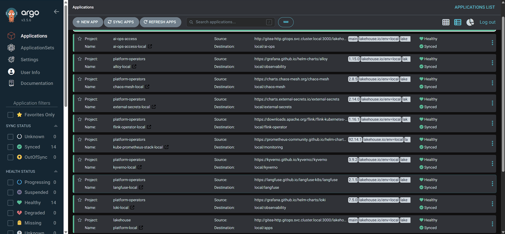
>
> 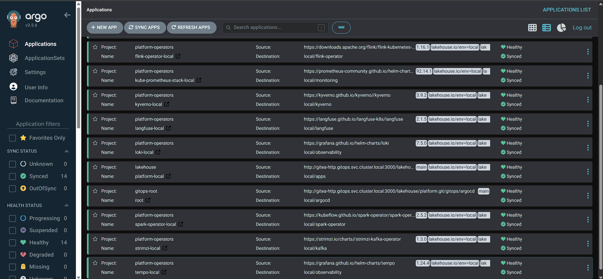
>
> **[Screenshot 02] Gitea: the repository Argo CD deploys from**
> File: `docs/lab/images/02-gitea-repository.png`
> How: open <http://localhost:3300>, sign in as `lakehouse` / `lakehouse-local-gitops`, open the `lakehouse/platform` repository, and show the file list with the latest commit message.
>
> 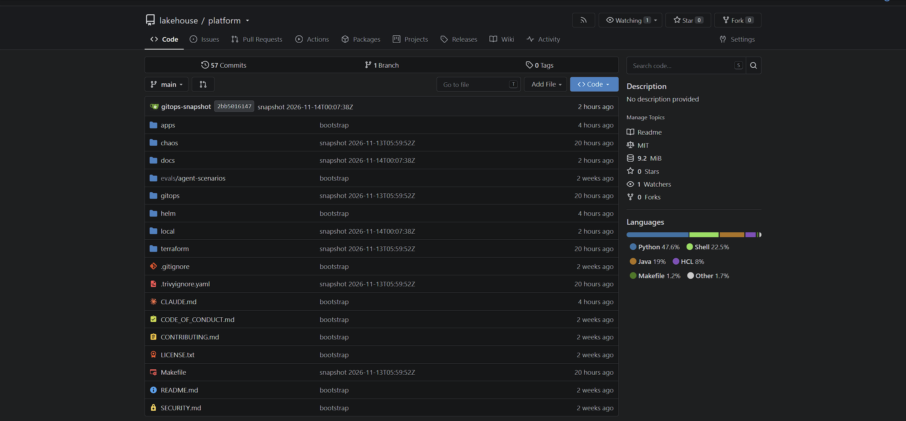
>
> **[Screenshot 03] Terminal: `make local-smoke` passing**
> File: `docs/lab/images/03-local-smoke.png`
> How: capture the terminal from the last check to the final summary line.
>
> 

## **Part 2: Tour of the UIs**

1. **Grafana:** open <http://localhost:3000> and sign in as `admin` / `admin-local-dev`. Go to **Dashboards**, folder **Lakehouse**. There are five dashboards: Overview, Ingestion SLO, Pipeline, Kafka, Tables.
2. **Prometheus:** open <http://localhost:9090>, then **Query**, run `min by (job) (up)` and open the **Table** tab. Every job should show `1` (all of its targets up). With more than 20 scrape pools, **Status > Target health** shows only one pool at a time.
3. **Alertmanager:** open <http://localhost:9093>. With a healthy platform only the `Watchdog` alert is active.
4. **Apicurio Registry:** no web UI is deployed; read the schema through its API in the browser: <http://localhost:8085/apis/ccompat/v7/subjects> lists the subjects, and <http://localhost:8085/apis/ccompat/v7/subjects/events.raw-value/versions/latest> shows the Avro schema of the events topic.
5. **Langfuse** is off by default (about 2 GiB, and nothing to trace until the agent has model access). `make langfuse-on` starts it (Part 8); then open <http://localhost:3001> and sign in as `admin@lakehouse.local` (password command in the Sign-in reference). `make langfuse-off` removes it again and keeps its data.

> **[Screenshot 04] Grafana: Lakehouse / Overview**
> File: `docs/lab/images/04-grafana-overview.png`
> How: Grafana > Dashboards > Lakehouse > **Lakehouse / Overview**, time range **Last 1 hour**. Show availability, error budget, freshness and event flow.
>
> 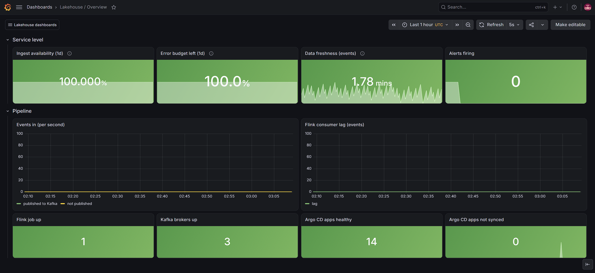
>
> **[Screenshot 05] Prometheus: all targets UP**
> File: `docs/lab/images/05-prometheus-targets.png`
> How: <http://localhost:9090> > **Query**, `min by (job) (up)`, **Table** tab. Show the list of jobs, each with the value `1`.
>
> 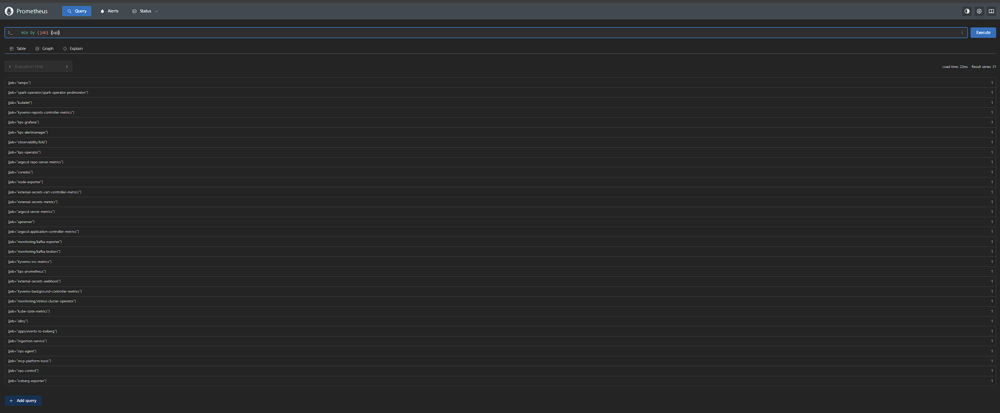
>
> **[Screenshot 06] Apicurio: the event schema**
> File: `docs/lab/images/06-apicurio-schema.png`
> How: open <http://localhost:8085/apis/ccompat/v7/subjects/events.raw-value/versions/latest> in the browser (Firefox and Chrome format JSON when you choose the "pretty print" option). Show the subject, version and schema fields.
>
> 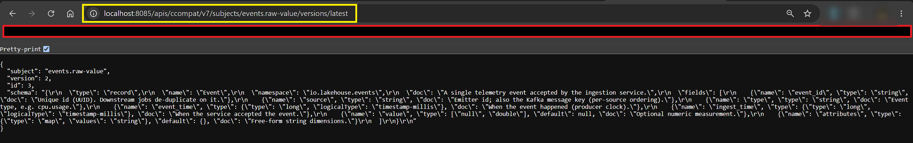

## **Part 3: Events, exactly once, schema evolution**

1. Send load through the real path (ingestion service, Kafka, Flink, Iceberg):

   ```bash
   make local-loadtest RATE=5000 DURATION=60
   ```

   While it runs, watch **Lakehouse / Ingestion SLO** and **Lakehouse / Pipeline** in Grafana: request rate, latency, consumer lag and table freshness.

2. Prove exactly once. **This test is destructive:** it deletes the `events.raw` topic, the consumer group and the table first.

   ```bash
   make local-test-exactly-once
   ```

   It sends three waves of 8,000 events with deliberate duplicate sends, kills a TaskManager in wave 2, stops and restores from a savepoint in wave 3, then re-sends 1,000 old events. Expected: **24,000 rows, 24,000 distinct ids, none missing**.

3. Add a column end to end without stopping the stream:

   ```bash
   make local-demo-schema-evolution
   ```

> **[Screenshot 07] Grafana: Lakehouse / Ingestion SLO during the load test**
> File: `docs/lab/images/07-grafana-ingestion-slo.png`
> How: open the dashboard while `make local-loadtest` runs (or set the time range to cover it). Show requests by outcome and the latency panel.
>
> 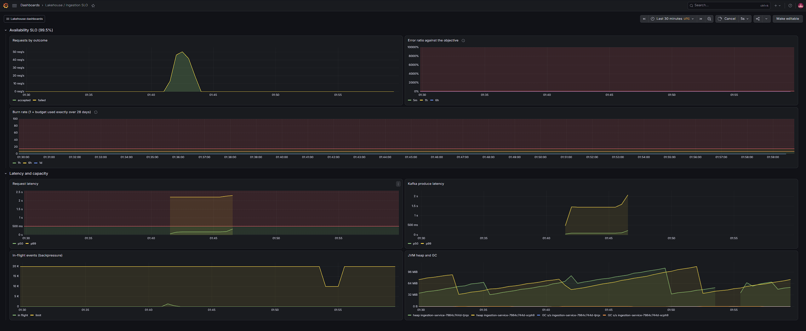
>
> **[Screenshot 08] Terminal: exactly-once result**
> File: `docs/lab/images/08-exactly-once-result.png`
> How: capture the final table of `make local-test-exactly-once` showing rows, distinct ids and duplicates per wave.
>
> 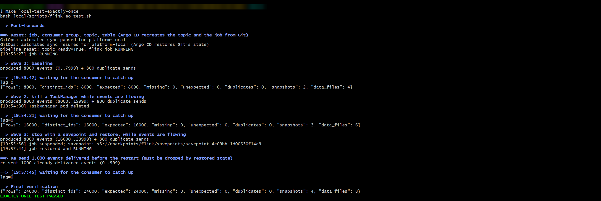
>
> **[Screenshot 09] Grafana: Lakehouse / Pipeline**
> File: `docs/lab/images/09-grafana-pipeline.png`
> How: time range covering the exactly-once test. Show the Flink restarts, checkpoints and consumer lag panels.
>
> 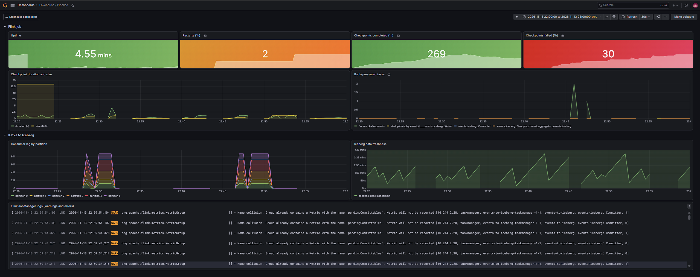

## **Part 4: Spark maintenance and aggregates**

1. Build the Spark image and load it into kind (once per code change):

   ```bash
   make local-deploy-spark
   ```

2. Run the maintenance job (compaction, manifest rewrite, snapshot expiry, orphan cleanup); it prints before and after statistics:

   ```bash
   make local-spark-maintenance
   ```

   Expected: fewer, larger data files and fewer manifests, with the same row count. Expiry removes only snapshots older than 24 hours (always keeping the last 5), so on a table reset within the last day the snapshot count still rises: compaction and Flink's checkpoint commits each add one. Send some load first (`make local-loadtest`) so there are small files to compact.

3. Build the hourly aggregate:

   ```bash
   make local-spark-aggregate
   ```

4. Show the scheduled jobs that run this automatically:

   ```bash
   make local-spark-schedules
   ```

> **[Screenshot 10] Grafana: Lakehouse / Tables before and after compaction**
> File: `docs/lab/images/10-grafana-tables-compaction.png`
> How: **Lakehouse / Tables**, time range covering the maintenance run. Show the data files and small-files panels dropping at the moment of the run.
>
> 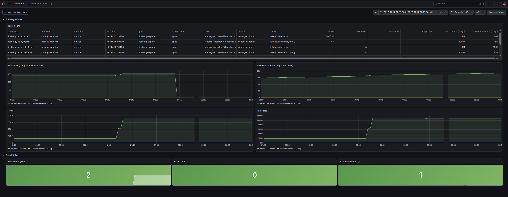
>
> **[Screenshot 11] Terminal: maintenance summary**
> File: `docs/lab/images/11-spark-maintenance-summary.png`
> How: capture the JSON summary printed at the end of `make local-spark-maintenance` (before and after files, snapshots, rows).
>
> 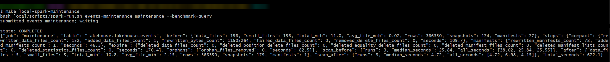

## **Part 5: A GitOps change, and drift**

1. Make a small, visible change, for example the iceberg-exporter's scrape interval or a Grafana dashboard title, under `helm/`. Check it renders for every environment:

   ```bash
   make helm-check
   ```

2. Publish it and watch Argo CD apply it (within about a minute):

   ```bash
   make gitops-push
   make gitops-status
   ```

3. See drift being corrected: change something Git declares by hand, then watch Argo CD put it back.

   ```bash
   kubectl --context kind-lakehouse -n apps scale deployment iceberg-exporter --replicas=0
   kubectl --context kind-lakehouse -n apps get deployment iceberg-exporter -w
   ```

   Within a minute the replica count returns to its value in Git. `Ctrl+C` stops the watch. Revert your change from step 1 and run `make gitops-push` again.

> **[Screenshot 12] Argo CD: the sync of your change**
> File: `docs/lab/images/12-argocd-sync.png`
> How: Argo CD > Applications > `platform-local` > **History and rollback** (or the application's tree right after the push). Show the new revision synced.
>
> 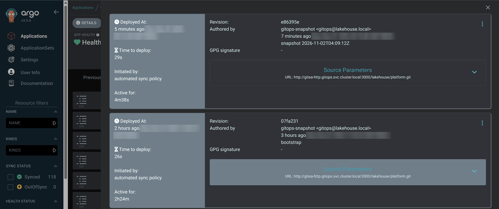

## **Part 6: Security checks**

1. Image vulnerabilities (gated), SBOMs, Terraform and Helm misconfigurations:

   ```bash
   make security-scan
   ```

2. Kafka mutual TLS and ACLs per identity, network policies (allowed and blocked paths), admission policies (each rule rejects its violation):

   ```bash
   make security-test
   ```

> **[Screenshot 13] Terminal: `make security-test` summary**
> File: `docs/lab/images/13-security-test-pt1.png`, `docs/lab/images/13-security-test-pt2.png`
> How: capture the three suites' pass counts (Kafka, network, admission).
>
> 
>
> 

## **Part 7: Alerts and a chaos experiment**

1. Unit-test the alert rules:

   ```bash
   make rules-test
   ```

2. Run one chaos experiment: one Kafka broker cut off for six minutes under load, with an alert timeline and an exactly-once check at the end (about 15 minutes):

   ```bash
   make chaos EXP=broker-isolation
   ```

   While it runs, watch Alertmanager (<http://localhost:9093>) and **Lakehouse / Kafka** in Grafana. Expected: `KafkaBrokerDown` and replication alerts fire, then resolve; no events lost or duplicated. The result is written to `docs/chaos/results/broker-isolation.json`.

> **[Screenshot 14] Alertmanager: alerts firing during the experiment**
> File: `docs/lab/images/14-alertmanager-firing.png`
> How: <http://localhost:9093> while the fault is active (minutes 4 to 6 of the experiment). Show `KafkaBrokerDown` and the replication alerts.
>
> 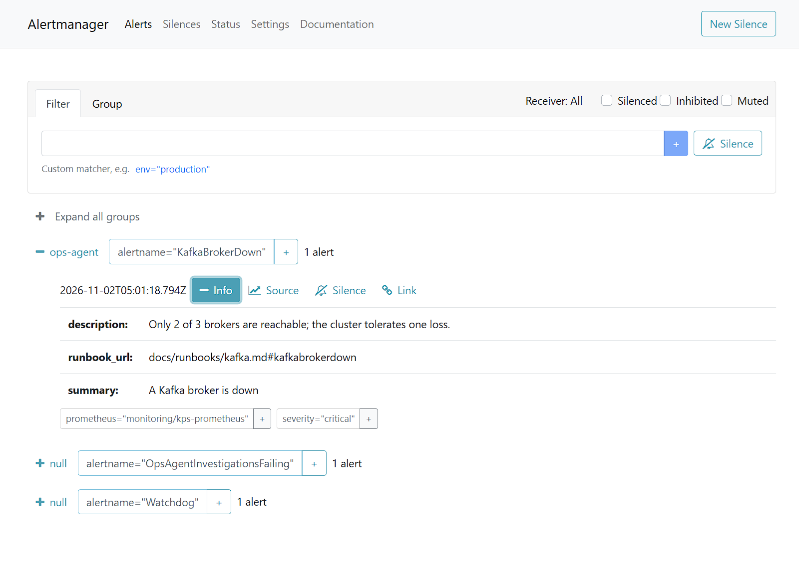
>
> **[Screenshot 15] Grafana: Lakehouse / Kafka during the outage**
> File: `docs/lab/images/15-grafana-kafka-outage.png`
> How: time range covering the experiment. Show brokers, under-replicated partitions and consumer lag rising and recovering.
>
> 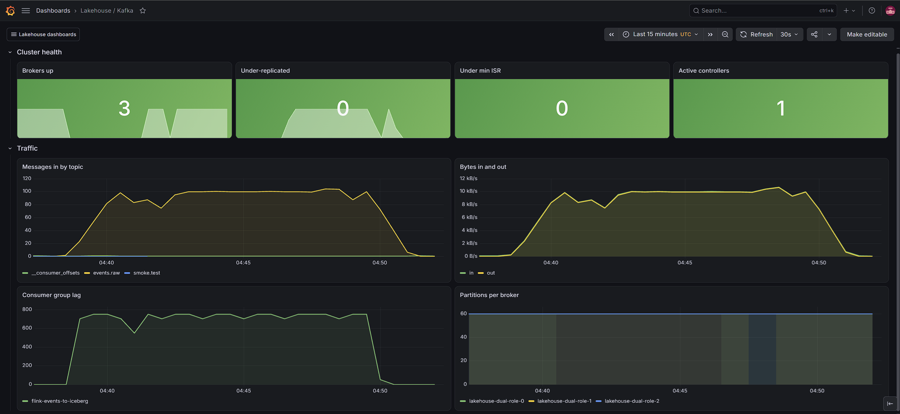
>
> **[Screenshot 16] Terminal: chaos result**
> File: `docs/lab/images/16-chaos-result.png`
> How: capture the end of `make chaos` output: events sent, events in Iceberg, missing and duplicates, recovery time, PASSED.
>
> 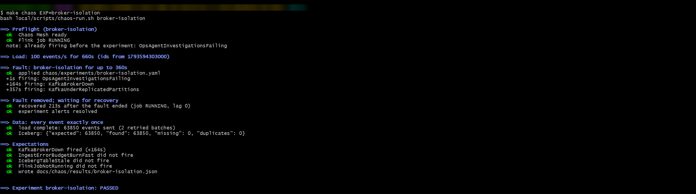

## **Part 8: The ops agent**

1. Unit tests (no cluster, no model):

   ```bash
   make ai-test
   ```

2. Build and deploy the MCP tool server, the agent and the approval service. Langfuse is optional (`make langfuse-on`; the agent runs untraced without it):

   ```bash
   make ai-deploy
   make langfuse-on    # optional: LLM tracing
   ```

3. The guardrail test: RBAC per service account, token checks, network policy, and a real approved action from the terminal with its full audit trail. It needs no model access.

   ```bash
   make ai-ops-test
   ```

4. Ask the platform questions through the on-call assistant (needs model access; see below):

   ```bash
   kubectl --context kind-lakehouse -n ai-ops exec -it deploy/hermes -- hermes chat
   ```

5. List and approve proposals from a terminal (the same flow Slack uses):

   ```bash
   kubectl --context kind-lakehouse -n ai-ops exec deploy/ops-control -- python -m ops_agent proposals --status pending
   kubectl --context kind-lakehouse -n ai-ops exec deploy/ops-control -- python -m ops_agent approve <id> --hash <first 12 characters> --approver <your name>
   ```

Model runs (live investigations, Hermes answers, `make ai-eval`) need access to Claude in Amazon Bedrock. With access granted, `make ai-creds` stores one hour of credentials for the agent; at the time of writing the lab account has no access, so these steps are not part of the recorded results.

> **[Screenshot 17] Terminal: `make ai-ops-test` passing**
> File: `docs/lab/images/17-ai-ops-test-pt1.png`, `docs/lab/images/17-ai-ops-test-pt2.png`
> How: capture the summary of the 37 checks, including the approved restart and the audit log line.
>
> 
>
> 
>
> **[Screenshot 18] Langfuse: an investigation trace (only with model access)**
> File: `docs/lab/images/18-langfuse-trace.png`
> How: <http://localhost:3001>, sign in as `admin@lakehouse.local`, project **Ops agent** > **Traces**, open the newest trace and show the agent run with its tool calls. Skip this screenshot while Bedrock access is pending.

## **Part 9: The AWS environment (optional, costs money)**

Everything here runs in your AWS account in `us-east-1`. A person confirms every `terraform apply`; read each plan before applying it. The environment costs about $0.40 an hour while it exists, so finish with step 8.

1. **Once per account: the bootstrap stack** (state bucket, budget alerts, audit trail). It stays after teardown.

   ```bash
   cd terraform/bootstrap
   cp terraform.tfvars.example terraform.tfvars      # set budget_alert_emails
   mv backend.tf backend.tf.off && terraform init && terraform apply
   mv backend.tf.off backend.tf
   terraform init -migrate-state -backend-config="bucket=lakehouse-tfstate-$(aws sts get-caller-identity --query Account --output text)"
   cd ../..
   ```

   Confirm the SNS subscription email AWS sends you.

2. **Your address for the EKS API:** copy `terraform/envs/dev/terraform.tfvars.example` to `terraform.tfvars` and put your public IP (from <https://checkip.amazonaws.com>) as `api_allowed_cidrs = ["<your ip>/32"]`.

3. **Plan, read, apply:**

   ```bash
   make aws-init aws-plan
   make aws-apply
   ```

4. **Deploy the platform** (images to ECR, signed with the KMS key; then the same GitOps bootstrap as kind). Docker Desktop must be running, and it needs the arm64 emulator first: the last image is the ops agent built for `linux/arm64` (AgentCore Runtime requires it), and on an x86 machine that build fails with `exec format error` after the other seven images were already pushed. `make aws-up` now checks this first and registers the emulator itself if it is missing (and stops at once if Docker is not running or the ECR login fails). To do it by hand, once (it lasts until Docker Desktop's VM is reset):

   ```bash
   docker run --privileged --rm tonistiigi/binfmt@sha256:400a4873b838d1b89194d982c45e5fb3cda4593fbfd7e08a02e76b03b21166f0 --install arm64
   docker run --rm --platform linux/arm64 alpine uname -m      # prints aarch64
   make aws-up
   ```

5. **Verify end to end and check the security controls:**

   ```bash
   make aws-smoke
   make aws-security-test
   ```

   Expected: Athena counts exactly the events sent (for example 5,000 rows, 5,000 distinct); Kafka, network and admission suites pass; a signed image is admitted and an unsigned one refused.

6. **Optional, the agent on Amazon Bedrock AgentCore:** connect the Gateway to the tool server, create the Runtime with a second apply, then test hop by hop:

   ```bash
   make aws-agentcore
   TF_VAR_agentcore_runtime=true make aws-plan
   make aws-apply
   make aws-ai-test
   ```

7. **Look at it:** port-forward the UIs from EKS with `KUBE_CONTEXT=lakehouse-dev bash local/scripts/ports.sh` (it skips Langfuse, Iceberg REST and S3, which run only on kind); Grafana's password comes from Secrets Manager (see Sign-in reference).

   > **[Screenshot 19] AWS console: the EKS cluster and its nodes**
   > File: `docs/lab/images/19-aws-eks-cluster.png`
   > How: sign in to the AWS console with your own account, region **N. Virginia (us-east-1)**, **Amazon EKS > Clusters > lakehouse-dev > Compute**. Show three nodes in three availability zones. Blur the account id in the top-right menu.
   >
   > 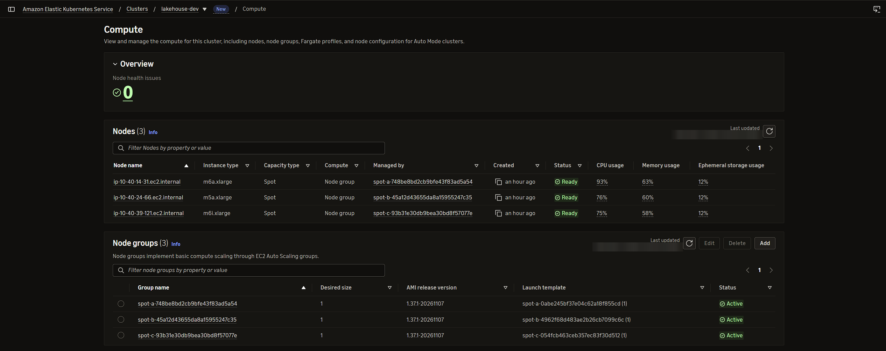
   >
   > **[Screenshot 20] AWS console: Athena counting the events exactly once**
   > File: `docs/lab/images/20-aws-athena-count.png`
   > How: **Amazon Athena > Query editor**, workgroup from `terraform -chdir=terraform/envs/dev output -raw athena_workgroup`, database from `... output -raw glue_database`. Run `SELECT count(*), count(DISTINCT event_id) FROM events` and show the result next to the query. Blur the account id.
   >
   > 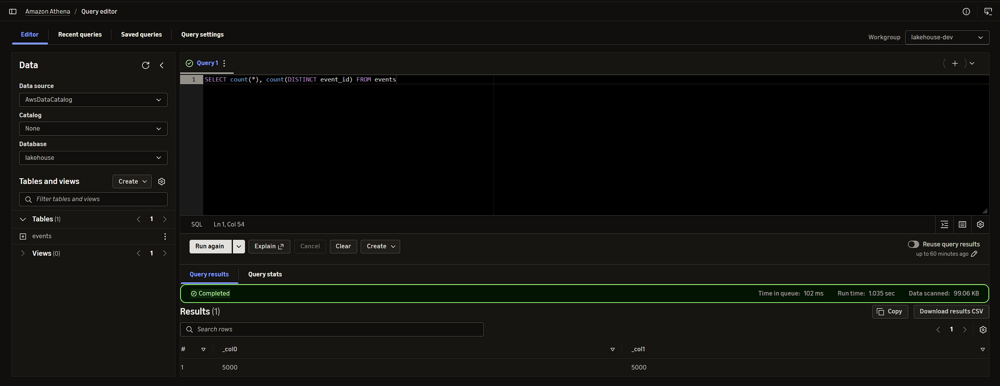
   >
   > **[Screenshot 21] Argo CD on EKS: every application Healthy**
   > File: `docs/lab/images/21-argocd-eks-pt1.png`, `docs/lab/images/21-argocd-eks-pt2.png`
   > How: with the EKS port-forwards running, <http://localhost:8090>, `admin` and the password printed by `ports.sh`. Same view as Screenshot 01.
   >
   > 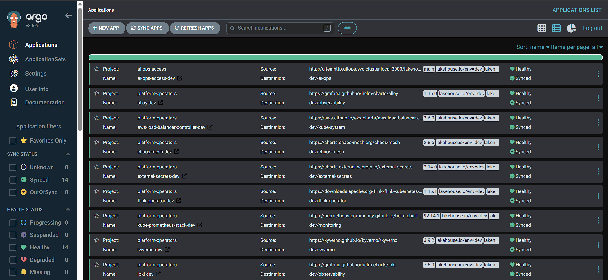
   >
   > 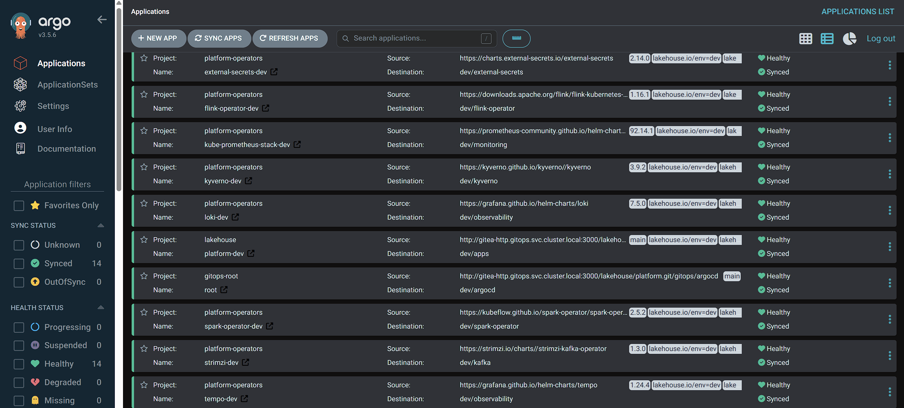

8. **Tear down and check for leftovers:**

   ```bash
   make aws-down
   ```

   It deletes the Kubernetes volumes and load balancers first, then runs `terraform destroy`, then deletes the environment's CloudWatch log groups and the older local Docker images (the newest build of each app image is kept; set `PURGE_DEV_IMAGES=1` to remove it too), then checks for leftovers (EBS volumes, load balancers, VPC, EKS, RDS, state). If you ran step 6 and it reports a VPC left: AgentCore releases its network interfaces up to 8 hours after the Runtime is deleted. Wait, then run `make aws-down` again.

> **[Screenshot 22] Terminal: `make aws-down` leftover check clean**
> File: `docs/lab/images/22-aws-down-clean.png`
> How: capture the leftover-check lines at the end (`ok` for each resource type, Terraform state empty). Make sure no account id or ARN is in the captured part.
>
> 

## **Part 10: Shutdown**

| **You want to**                           | **Run**                                                                                                                                       |
| ----------------------------------------- | --------------------------------------------------------------------------------------------------------------------------------------------- |
| **Pause the lab and keep all data**       | `docker stop lakehouse-control-plane lakehouse-worker lakehouse-worker2 lakehouse-worker3`                                                    |
| **Resume later**                          | `docker start lakehouse-control-plane lakehouse-worker lakehouse-worker2 lakehouse-worker3`, then `make gitops-status` and `make local-smoke` |
| **Delete the local cluster and its data** | `make local-down` (rebuilding takes 20-40 minutes)                                                                                            |
| **Remove the AWS environment**            | `make aws-down` (the bootstrap stack stays by design)                                                                                         |

The kind node containers may be set not to start with Docker Desktop (`docker update --restart=no ...`); then start them by hand as above.

## **Troubleshooting**

| **Symptom**                                                                                 | **Fix**                                                                                                                                                                                                                                                                                                                                                                                                                                                             |
| ------------------------------------------------------------------------------------------- | ------------------------------------------------------------------------------------------------------------------------------------------------------------------------------------------------------------------------------------------------------------------------------------------------------------------------------------------------------------------------------------------------------------------------------------------------------------------- |
| **`kubectl` hangs after Docker or WSL restarted**                                           | `docker restart lakehouse-control-plane`                                                                                                                                                                                                                                                                                                                                                                                                                            |
| **Commands reach the wrong cluster**                                                        | Pass `--context kind-lakehouse` (or set `KUBE_CONTEXT`); the default context may be an old EKS one                                                                                                                                                                                                                                                                                                                                                                  |
| **A manual change keeps being undone**                                                      | Argo CD self-heal. Pause sync first: `source local/scripts/lib.sh && gitops_pause`, later `gitops_resume`                                                                                                                                                                                                                                                                                                                                                           |
| **`make gitops-push` hangs**                                                                | Your GPG agent is asking for the signing passphrase; unlock it and run again                                                                                                                                                                                                                                                                                                                                                                                        |
| **Pods `Pending` or `OOMKilled`**                                                           | Give Docker Desktop more memory (20 GB or more; see Memory below)                                                                                                                                                                                                                                                                                                                                                                                                   |
| **Spark jobs or drills take many times longer than usual**                                  | Check memory (`make local-load`, below). After hours of runs, image loads or a standby, restart the nodes: `docker stop` then `docker start` the four `lakehouse-*` containers                                                                                                                                                                                                                                                                                      |
| **An alert fired**                                                                          | Open its runbook: every alert's `runbook_url` points to a section in [**docs/runbooks/**](../runbooks/)                                                                                                                                                                                                                                                                                                                                                             |
| **A script stops with `port-forward ... failed` and `forbidden by its access permissions`** | Windows reserved the port (Hyper-V/WSL/Docker take ranges, e.g. 8002-8101 hides 8081, 8082, 8085, 8090). Check with `netsh interface ipv4 show excludedportrange protocol=tcp`. In an administrator shell: `net stop winnat` then `net start winnat` (restart Docker Desktop afterwards), or reboot. To keep Windows from taking them again: `netsh int ipv4 add excludedportrange protocol=tcp startport=8081 numberofports=2` (repeat for 8085, 8090, 8181, 8333) |
| **`aws-up` fails building the arm64 image with `exec format error`**                        | Register the emulator: `docker run --privileged --rm tonistiigi/binfmt@sha256:400a4873b838d1b89194d982c45e5fb3cda4593fbfd7e08a02e76b03b21166f0 --install arm64`, then `make aws-up` again                                                                                                                                                                                                                                                                           |
| **`aws-down` reports a VPC left after the agent step**                                      | Wait for AgentCore to release its network interfaces (up to 8 hours), then `make aws-down` again                                                                                                                                                                                                                                                                                                                                                                    |

### **Memory**
`make local-load` prints memory and CPU per pod and per namespace from Prometheus, plus what the Docker VM has left (the cluster has no metrics-server, so `kubectl top` does not work).

Measured once at rest on 2026-11-23, after a fresh start of the nodes:

| **What**                         | **Memory** |
| -------------------------------- | ---------- |
| **Docker VM (this laptop)**      | 19.2 GiB   |
| **Cluster at rest, Langfuse on** | 14.8 GiB   |
| **Langfuse (off by default)**    | 2.1 GiB    |
| **Kafka (3 brokers)**            | 3.0 GiB    |
| **Flink, ingestion (`apps`)**    | 2.8 GiB    |
| **Kubernetes control plane**     | 2.3 GiB    |
| **Each Spark job**               | ~4 GiB     |

CPU was not the limit: about 1.6 of 16 cores at rest. With Langfuse on, the VM had 3.1 GiB free and had already moved 0.4 GiB to swap, so a Spark job plus the Spark test container pushed it further into swap. With Langfuse off it had 4.9 GiB free.

On Windows, Docker Desktop's VM gets half the host's memory unless `%UserProfile%\.wslconfig` says otherwise. To give it more, for example 24 GB on a 40 GB machine:

```ini
[wsl2]
memory=24GB
```

Then `wsl --shutdown` and start Docker Desktop again. Leave enough for Windows itself.

## **Screenshot checklist**

| **#**  | **File**                                     | **Part** |
| ------ | -------------------------------------------- | -------- |
| **01** | `01-argocd-applications-pt1.png`, `-pt2.png` | 1        |
| **02** | `02-gitea-repository.png`                    | 1        |
| **03** | `03-local-smoke.png`                         | 1        |
| **04** | `04-grafana-overview.png`                    | 2        |
| **05** | `05-prometheus-targets.png`                  | 2        |
| **06** | `06-apicurio-schema.png`                     | 2        |
| **07** | `07-grafana-ingestion-slo.png`               | 3        |
| **08** | `08-exactly-once-result.png`                 | 3        |
| **09** | `09-grafana-pipeline.png`                    | 3        |
| **10** | `10-grafana-tables-compaction.png`           | 4        |
| **11** | `11-spark-maintenance-summary.png`           | 4        |
| **12** | `12-argocd-sync.png`                         | 5        |
| **13** | `13-security-test-pt1.png`, `-pt2.png`       | 6        |
| **14** | `14-alertmanager-firing.png`                 | 7        |
| **15** | `15-grafana-kafka-outage.png`                | 7        |
| **16** | `16-chaos-result.png`                        | 7        |
| **17** | `17-ai-ops-test-pt1.png`, `-pt2.png`         | 8        |
| **18** | `18-langfuse-trace.png`                      | 8        |
| **19** | `19-aws-eks-cluster.png`                     | 9        |
| **20** | `20-aws-athena-count.png`                    | 9        |
| **21** | `21-argocd-eks-pt1.png`, `-pt2.png`          | 9        |
| **22** | `22-aws-down-clean.png`                      | 9        |
